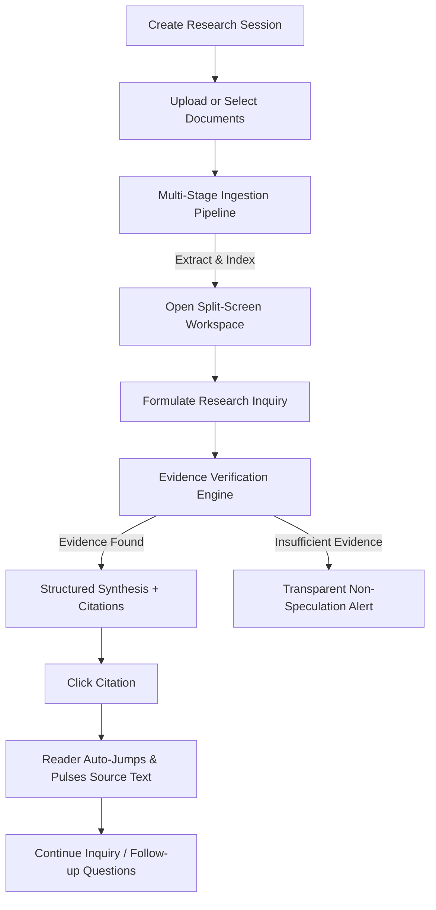

# ResearchFlow — AI Research Workspace: UX Case Study & Product Architecture

> **Product Principle:** *Make complex research feel clear, traceable, and effortless.*

---

## 1. Executive Summary & Product Vision

Modern generative artificial intelligence has unlocked unprecedented velocity for summarization and information synthesis. However, it has simultaneously triggered a profound crisis of epistemic trust:
- Generic chat interfaces decouple answers from their grounding documents.
- Models generate plausible-sounding yet completely fabricated claims (hallucinations).
- Users spend more time fact-checking detached chatbot outputs than they would have spent conducting manual reading.

**ResearchFlow** was conceived to fundamentally redesign the interaction paradigm between researchers and AI. Instead of another conversational chatbot, ResearchFlow places the **document and its verifiable evidence at the absolute center of the experience**.

The product seamlessly combines:
1. A synchronized split-screen reading and analytical workspace.
2. An autonomous, transparent local evidence engine that executes citation-grounded RAG without external API lock-in.
3. Interactive, bidirectional citations that instantly jump to exact pages, scroll to paragraphs, and pulse the source text.
4. An uncompromising honesty protocol that transparently declares when documents lack sufficient evidence rather than speculating.

---

## 2. Target Audience & Problem Discovery

### Target User Segments
1. **University & Graduate Students:**
   - *Context:* Reviewing academic papers, preparing literature reviews, writing theses.
   - *Pain Point:* Difficulty tracking which paper asserted which finding, formatting bibliographies, and navigating complex mathematical/methodological sections.
2. **Academic & Industrial Researchers:**
   - *Context:* Comparing experimental architectures, benchmark datasets, and quantitative performance metrics.
   - *Pain Point:* Generic AI assistants omit critical experimental conditions, hyperparameters, or training constraints.
3. **Policy Analysts & Knowledge Workers:**
   - *Context:* Reviewing multi-hundred-page regulatory dossiers, climate assessments, or legal briefs.
   - *Pain Point:* High-liability environments where an unsubstantiated hallucination can invalidate policy recommendations.

---

## 3. Core User Journey



### Flow Breakdown:
1. **Session Initiation:** The user defines an analytical scope (e.g., "Transformer Architecture Analysis").
2. **Document Ingestion:** The user uploads PDFs or selects pre-indexed peer-reviewed literature. Multi-stage feedback displays `Uploading` → `Extracting Text` → `Processing Paragraphs` → `Indexing Sections` → `Ready`.
3. **Split-Screen Workspace:** The left panel renders the document with responsive zoom, page navigation, and in-document search; the right panel hosts the research conversation.
4. **Evidence-Grounded Synthesis:** The AI responds with:
   - Executive synthesis.
   - Bulleted key findings with inline citation markers (`[Doc, p. X]`).
   - Verbatim excerpt cards with relevance match meters.
   - Suggested follow-up inquiries.
5. **Bidirectional Verification:** Clicking any citation automatically scrolls the reader to that exact page and highlights the backing excerpt with an animated pulse.
6. **Transparent Fallback:** If the active documents lack sufficient text matching the query, the engine presents an amber alert explaining the gap rather than hallucinating.

---

## 4. Information Architecture (IA)

```
ResearchFlow Application Root
│
├── Top Navigation Bar
│   ├── Brand & Version Badge
│   ├── Inline Editable Session Title
│   ├── Navigation View Switcher (Workspace | Library | UX Case Study)
│   ├── RAG Engine Mode Pill (Local vs Gemini)
│   └── Actions (New Session, Upload, Export Markdown, Settings)
│
├── Sidebar (Collapsible)
│   ├── Active In-Scope Document Toggles (Checkboxes)
│   ├── Research Session History (Resume / Delete)
│   └── Storage Utilization & Sample Dataset Reset
│
├── Main Viewport (Tab-Driven)
│   │
│   ├── Workspace View (Split-Screen 54/46)
│   │   ├── Left: Document Reader
│   │   │   ├── Document Toolbar (Title, Page Navigation, Zoom, Search, Metadata)
│   │   │   ├── Canvas Reading Surface (Comfortable line length, Typography)
│   │   │   └── Animated Citation Highlight Pulser
│   │   ├── Center: Draggable Panel Resizer
│   │   └── Right: Research Conversation
│   │       ├── Active Scope Header (X documents, Y pages)
│   │       ├── Grounded Answer Cards (Executive, Bullets, Excerpts, Follow-ups)
│   │       └── Question Composer (Auto-growing input, prompt shortcuts)
│   │
│   ├── Document Library View
│   │   ├── Search & Format Filters (All, PDF, TXT, MD)
│   │   ├── Document Cards (Status, file size, pages, upload date)
│   │   └── Document Chunks Inspection Modal
│   │
│   ├── Sessions View (History)
│   │   └── Multi-Session Management & Resume
│   │
│   └── Case Study & Specs View
│
└── Modals
    ├── Upload Modal (Multi-stage drag-and-drop ingestion)
    └── Settings Modal (AI mode, Gemini API Key, auto-scroll preferences, data export)
```

---

## 5. Visual Identity & Design System

### Design Tokens
- **Canvas Navy (`#0A0F1E`):** Low-strain background for prolonged reading sessions.
- **Slate Surfaces (`#12182B`, `#1E2440`, `#283258`):** Layered card elevations and subtle visual dividers.
- **Brand Indigo (`#6366F1`):** Intentional accent color for primary actions, focus outlines, and citations.
- **Lavender (`#E0E7FF`):** Readable, high-contrast text accents and badge backgrounds.
- **Verification Green (`#10B981`):** Signal for verified citations and high confidence scores.
- **Warning Amber (`#F59E0B`):** Honest alerts when evidence is insufficient or missing.

### Typography
- **Headings & Badges:** `Space Grotesk` (weights 600, 700) for a precise, academic feel.
- **UI & Reading Surface:** `Inter` (weights 400, 500, 600) with a 1.75 line-height ratio for high readability.
- **Code & Citations:** `JetBrains Mono` for page numbers and formula terms.

---

## 6. Citation & Trust Design Protocol

To eliminate the "black box" syndrome of conversational AI, ResearchFlow follows five trust principles:

| Principle | Traditional Chatbot | ResearchFlow Implementation |
|---|---|---|
| **Attribution** | Vague claims ("According to studies...") | Precise citation: `[Attention Is All You Need, p. 4]` |
| **Verification Speed** | User must manually open PDF and search | One-click auto-scroll directly to page and paragraph |
| **Visual Evidence** | Detached text only | Reader pulses source paragraph with an animated indigo border |
| **Confidence Transparency** | Hidden or non-existent | Explicit match confidence rating displayed (e.g. `98% Match`) |
| **Negative Response** | Hallucinates plausible answer | Transparent refusal: "Zero evidence found in active documents" |

---

## 7. Accessibility & Responsive Design

- **Semantic Hierarchy:** Single `h1` per view, semantic `header`, `aside`, `main`, and `mark` elements.
- **Keyboard Navigation:** Full keyboard operability for document navigation (Arrow keys, Enter to send inquiry, Shift+Enter for newline).
- **Visible Focus Rings:** Customized 2px outline for all interactive buttons, inputs, and toggles.
- **Mobile Adaptive Layout:** On screens under 900px, a floating pill toggle allows seamless switching between `Document Reader` and `Research Chat`, preserving active document position and citation links.
- **Screen Contrast:** All text passes WCAG AA contrast criteria (contrast ratio ≥ 4.5:1 against slate backgrounds).

---

## 8. Usability Testing Protocol (Framework for Future Testing)

### Objective Metrics
1. **Time-to-Verification (TTV):** Measure the duration from when a participant finishes reading an answer to when they verify the backing text in the document.
2. **Citation Interactivity Rate:** Percentage of answers where users click through to verify citations.
3. **Session Resumption Frequency:** Frequency with which participants return to previous research sessions to continue an inquiry.

### Test Scenarios
- **Task 1 (Quantitative Fact Finding):** Locate the BLEU score and training hardware for the Transformer big model.
- **Task 2 (Policy Synthesis):** Determine how many GW of renewable capacity were stalled in grid interconnection queues in the Climate Action report.
- **Task 3 (Honest Negative Evaluation):** Ask a question about an unrelated topic (e.g., "What is the capital of Australia?") and confirm that the system displays an honest negative response without hallucinations.

---

## 9. Future Roadmap & Iterations

- [ ] **Multi-Column PDF Layout Preservation:** Canvas-level bounding box highlights for complex two-column academic formats.
- [ ] **OCR Engine Integration:** Tesseract.js / WebAssembly pipeline for scanned archival documents.
- [ ] **Cross-Document Comparative Matrix:** Side-by-side tabular comparison of findings across multiple uploaded papers.
- [ ] **Collaborative Shared Research:** Real-time multi-user sessions with shared notes and annotated citations.

---

*Authored for the ResearchFlow AI Research Workspace Design Portfolio.*
